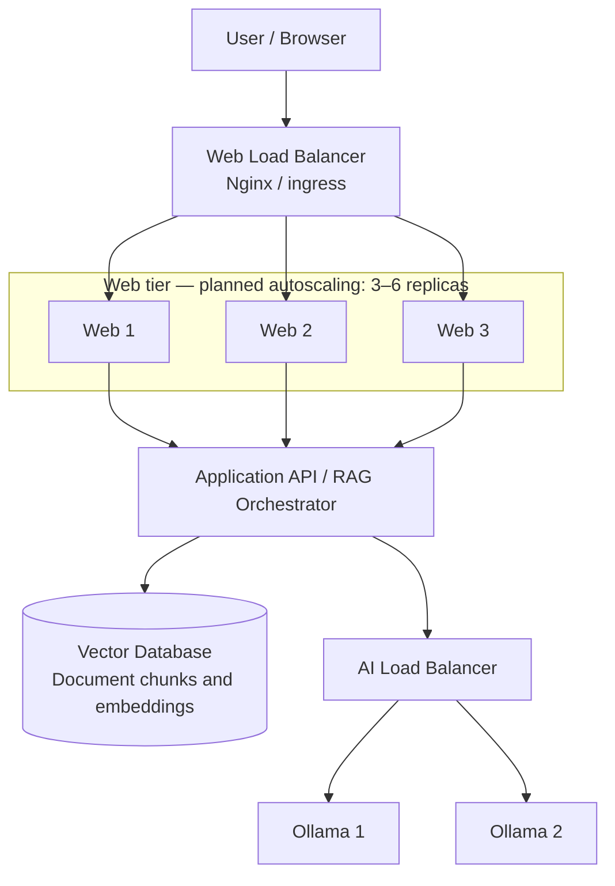

# Python Troubleshooting RAG AI App on GCP — Containerized Deployment

A containerized AI project aimed at helping users understand and fix **vanilla Python errors**. The intended chatbot combines a user's question, code, and traceback with relevant documentation through retrieval-augmented generation (RAG), then explains what went wrong, why it happened, and how to fix it.

Google Cloud Platform (GCP) is the intended deployment environment. This repository currently contains a frontend connected to a FastAPI development mock through Nginx, plus a separate Docker Compose AI inference tier; it does not yet provide a complete, connected RAG application or GCP provisioning configuration.

## What the chatbot is designed to do

Users describe their problem, paste their Python code, and include the traceback or error message. The intended answer format follows the frontend's example:

- **Meaning:** explain the error in plain language.
- **Cause:** identify the operation or code pattern responsible.
- **Fix:** suggest a correction with a small code example.
- **Reasoning:** explain why the correction works.
- **Sources:** identify the documentation used to support the answer once retrieval is connected.

For example, `"Age: " + 25` raises a `TypeError` because it attempts to concatenate a string and an integer. The frontend demonstrates fixes using `str(25)` or an f-string.

## Python troubleshooting scope

The intended knowledge base focuses on Python itself:

| Topic | Troubleshooting focus |
| --- | --- |
| Built-in exceptions | Understanding errors such as `TypeError`, `ValueError`, `NameError`, `IndexError`, and `KeyError`. |
| Tracebacks | Reading the call stack and locating the failing line. |
| Types | Working with strings, numbers, collections, conversions, and incompatible operations. |
| Functions | Understanding arguments, return values, scope, and common calling errors. |
| Imports | Diagnosing module resolution, import paths, and missing modules. |
| Files | Handling paths, file modes, missing files, and file access errors. |
| Exception handling | Using `try`, `except`, `else`, `finally`, and `raise` appropriately. |

It is important to notice the dataset includes information about third-party data science tools, but the frontend aims for a vanilla Python troubleshooting chatbot. It is currently being discussed which will be the focus of the product.

<!-- Although the dataset includes information about third-party data science tools, the product direction is a vanilla Python troubleshooting chatbot. Dataset selection and retrieval should support that scope; third-party library content does not define the app's intended coverage. -->

## Current implementation

| Component | What is available |
| --- | --- |
| Frontend | Plain HTML, CSS, and JavaScript with question, code, and error fields; validation; a loading state; and POST requests to `/api/ask`. Renders the API message and explanation sections using `textContent`. |
| AI inference | Ollama configured with `qwen2.5:1.5b` for generation and `nomic-embed-text` for embeddings. |
| Container orchestration | `docker-compose.web.yml` builds frontend Nginx and Python 3.12 API containers. The separate AI Compose file manages model initialization, two inference replicas, shared model storage, and an AI proxy. |
| Request routing | Web Nginx serves the UI on host port 8080 and proxies `/api/` to `backend:8001`. The separate AI Nginx provides least-connections balancing, rate limiting, timeouts, and retries. |
| Python client | Helpers for generating embeddings and requesting answers using caller-supplied document chunks. Responses include source names and inference metrics, with rate-limit and request-failure handling. |
| Application API | FastAPI `POST /api/ask` with strict request/response validation and explicit development mock mode. Live mode returns unavailable until retrieval and inference are connected. |
| Retrieval and integration | Frontend-to-backend communication is connected in mock mode. Document ingestion, a vector store, retrieval logic, and live AI orchestration are not implemented in this checkout. |
| GCP deployment | Deployment target; cloud infrastructure and deployment automation are not included yet. |

**The web stack currently runs in development mock mode.** The browser calls the backend, which returns the same fixed TypeError explanation for every valid request. It makes no AI requests, performs no document retrieval, and never executes submitted code. The mock is a connection check, not a diagnosis of the submitted input.

The AI client's prompt, fallback message, and standalone test still refer to Linux administration. They are scaffolding that needs to be adapted to the Python troubleshooting scope before integration.

## Intended RAG workflow

The following provisional diagram describes the **proposed target architecture**. The web tier is intended to scale automatically from **3 to 6 replicas**; that scaling and the complete architecture are not yet implemented in this repository.



The web load balancer distributes browser traffic across the web replicas. The application API coordinates retrieval from the vector database and inference through the separate AI load balancer. The steps below describe the intended request and response workflow; the diagram's arrows show routing and service dependencies.

1. Prepare and index documentation relevant to the Python topics above.
2. Accept the user's question, code, and traceback through the frontend and an application API.
3. Generate an embedding and retrieve relevant documentation chunks from a vector store.
4. Pass the question and retrieved context to the AI client.
5. Route inference through Nginx to an Ollama replica.
6. Return an explanation and supporting sources to the frontend.

The repository provides the inference configuration, client helpers, and a validation/mock API for parts of this workflow. Browser-to-API integration is implemented; indexing, retrieval, and live API orchestration remain future work.

## Repository layout

```text
.
├── README.md
├── docker-compose.web.yml        # Frontend + API development mock stack
├── docs/
│   ├── api-contract.md           # API schema and live-flow target
│   └── integration-checks.md     # Verified results and browser checklist
├── backend/
│   ├── README.md                 # API setup, mock mode, and contract checks
│   ├── Dockerfile                # Python 3.12 + Uvicorn on port 8001
│   ├── app.py                    # POST /api/ask and envelope error handling
│   ├── models.py                 # Validated request and response models
│   └── tests/test_api.py         # Request and response contract checks
├── frontend/
│   ├── README.md                 # Compose/Codespaces startup and troubleshooting
│   ├── Dockerfile                # Static assets copied into Nginx image
│   ├── nginx.conf                # Static files and /api/ reverse proxy
│   ├── index.html                # Troubleshooting form and explanation panel
│   ├── styles.css                # Responsive interface styling
│   ├── app.js                    # Form validation and response rendering
│   └── sample-responses.js       # Example inputs and legacy local response provider
└── ai-tier/
    ├── SETUP.md                  # AI-tier setup notes
    ├── docker-compose.ai.yml     # Model initialization, inference, and proxy services
    ├── nginx-ai.conf             # Load balancing and request limits
    └── ai_client.py              # Embedding and context-based generation helpers
```

## Run the frontend and API

Prerequisites: Docker with the Docker Compose plugin and internet access for the first image/dependency downloads. From the repository root:

```bash
docker compose -f docker-compose.web.yml up -d --build
docker compose -f docker-compose.web.yml ps
```

Open `http://localhost:8080`, then select **Load example → Get explanation**. In GitHub Codespaces, add `8080` in the **Ports** tab with **Forward a Port**, then use its **Open in Browser** link. Ports 3000 and 3001 are not the web endpoint configured by this Compose file.

The request path is browser → web Nginx on port 8080 → FastAPI at `backend:8001` on the Compose network. The backend is not published directly to the host. Compose explicitly sets `API_MOCK_MODE: "true"` (underscores are required). Ollama and a database are not needed for this mock flow.

Opening `index.html` directly, using Live Preview, or serving the folder with `python -m http.server` does not provide the `/api/` proxy. Use the Compose URL for integration testing.

The Dockerfiles copy source files into images; rebuild after frontend or backend code changes. After changing only the backend environment in Compose, recreate the backend with `docker compose -f docker-compose.web.yml up -d --force-recreate backend`. A restart alone does not apply changed environment settings.

For frontend-only edits:

```bash
docker compose -f docker-compose.web.yml up -d --build frontend
```

Hard-refresh the browser with **Ctrl+Shift+R** (Windows/Linux) or **Command+Shift+R** (Mac). Stop the web stack with:

```bash
docker compose -f docker-compose.web.yml down
```

See [frontend startup and troubleshooting](frontend/README.md), [backend setup and configuration](backend/README.md), and [integration checks](docs/integration-checks.md). The backend README also covers running the API directly on host port 8001 for API-only development.

## Run the AI inference tier

Prerequisites: Docker with the Docker Compose plugin, Python 3, internet access for the initial image/model downloads, and sufficient disk and memory for two model-serving replicas. The Compose configuration sets a 3,500 MB memory limit per inference replica, plus resources for the proxy and initialization service.

From the repository root:

```bash
cd ai-tier
docker compose -p ai-tier -f docker-compose.ai.yml up -d
docker compose -p ai-tier -f docker-compose.ai.yml ps
```

The explicit project name matches the replica hostnames referenced in `nginx-ai.conf`. The initialization container downloads both models into `ai-tier/models/` before the inference replicas start. That initialization container is expected to exit after staging the models.

The proxy exposes the inference endpoint at `http://127.0.0.1:11434` on the host. Within the Compose backend network, the proxy is available at `http://ai-lb:11434`; the Python client's URL must be adjusted if it runs there.

To try the standalone client in a virtual environment, while still in `ai-tier/`:

```bash
python3 -m venv .venv
source .venv/bin/activate
python -m pip install requests
python ai_client.py
```

This runs the existing Linux administration example with hardcoded context. It checks the inference path without a vector database or frontend connection. The client reports source names, token throughput, total inference latency, and an estimated time to first token based on Ollama timings; generation is requested without streaming.

To stop the AI services:

```bash
docker compose -p ai-tier -f docker-compose.ai.yml down
```

See [the AI-tier setup notes](ai-tier/SETUP.md) for additional context.

## Path to a connected GCP deployment

The next implementation steps follow [the API contract](docs/api-contract.md): finish the documented UI/proxy limits, align and validate structured Python generation, and add vector retrieval to the API. Documentation ingestion and GCP hosting, networking, access controls, and deployment automation must also be defined before the project can be presented as a deployed end-to-end service.
