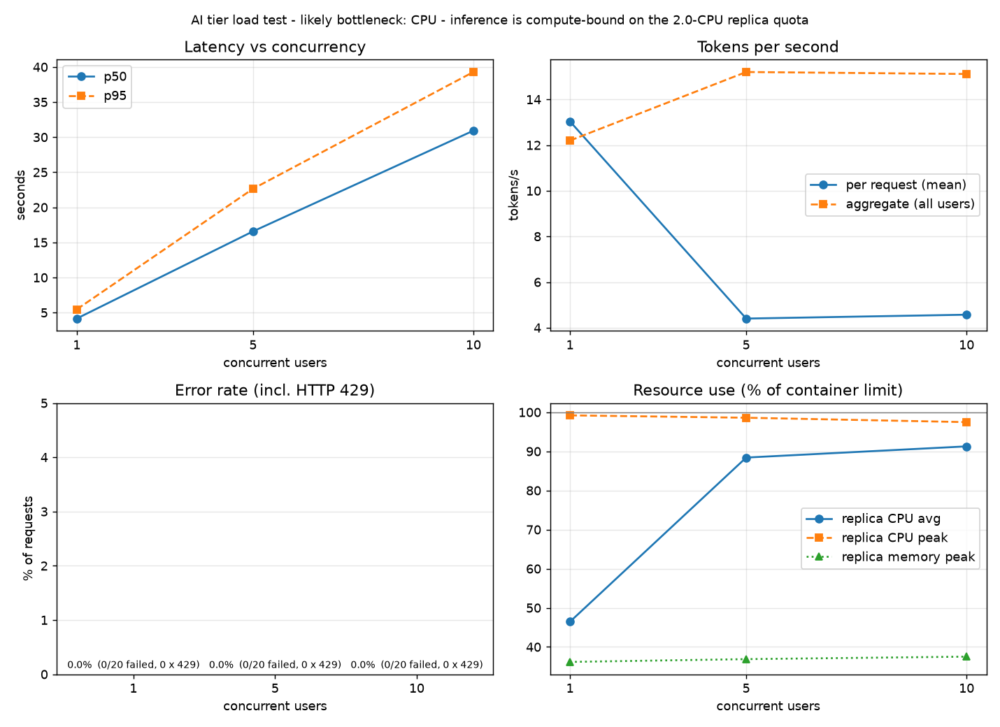

# AI tier test run - 20261128T173823Z

| Field | Value |
|---|---|
| Started (UTC) | 2026-11-28T17:38:23Z |
| Ended (UTC) | 2026-11-28T17:42:52Z |
| Tests run | preflight, load, ratelimit |
| AI tool used to build the tests | Claude (Anthropic, claude.ai chat) (Claude Sonnet 5.5) |
| Who/what executed the tests | Human running tests/run_tests.sh |
| Prompt(s) | see `tests/PROMPTS.md` (copied below) |
| Git commit | 956bc9f |
| Endpoint | http://127.0.0.1:11434 |

## Summary

| Test | Result | PASS | FAIL | WARN | SKIP |
|---|---|---|---|---|---|
| preflight | PASS | 5 | 0 | 0 | 0 |
| load | PASS | 6 | 0 | 0 | 0 |
| ratelimit | PASS | 5 | 0 | 0 | 0 |

## preflight

Started 2026-11-28T17:38:23Z - ended 2026-11-28T17:38:25Z - result **PASS**

| ID | Check | Result | Detail |
|---|---|---|---|
| P1 | AI endpoint reachable through the load balancer | PASS | GET http://127.0.0.1:11434/ -> HTTP 200 |
| P2 | Model 'qwen2.5:1.5b' is staged | PASS | models listed: ['qwen2.5:1.5b', 'nomic-embed-text:latest'] |
| P3 | Two inference replicas are running | PASS | found 2: ['ai-tier-ollama-1', 'ai-tier-ollama-2'] |
| P4 | Load balancer container 'ai-lb' is running | PASS | state=running health=none |
| P5 | A real inference request succeeds end-to-end | PASS | HTTP 200 in 1.42s |

## load

Started 2026-11-28T17:38:25Z - ended 2026-11-28T17:42:39Z - result **PASS**

| ID | Check | Result | Detail |
|---|---|---|---|
| L1 | Every concurrency level completed with at least one successful request | PASS | c=1: 20/20 ok, c=5: 20/20 ok, c=10: 20/20 ok |
| L2 | Error rate <= 5.0% at every level | PASS | c=1: 0.0%, c=5: 0.0%, c=10: 0.0% |
| L3 | Latency (p50/p95), tokens/sec and error rate recorded for each level (CSV) | PASS | tests/results/20261128T173823Z/load_results.csv |
| L4 | Results charted | PASS | load_chart.png |
| L5 | Bottleneck identified from the data | PASS | CPU - inference is compute-bound on the 2.0-CPU replica quota |
| L6 | Containers still running and healthy after the load test | PASS | {'ai-tier-ollama-1': ('running', 'healthy'), 'ai-tier-ollama-2': ('running', 'healthy'), 'ai-lb': ('running', 'none')} |

| Users | Requests | Error % | p50 (s) | p95 (s) | tok/s per request | tok/s aggregate | req/s |
|---|---|---|---|---|---|---|---|
| 1 | 20 | 0.0 | 4.15 | 5.46 | 13.0 | 12.2 | 0.23 |
| 5 | 20 | 0.0 | 16.58 | 22.65 | 4.4 | 15.2 | 0.28 |
| 10 | 20 | 0.0 | 30.92 | 39.28 | 4.6 | 15.1 | 0.27 |

**Likely bottleneck:** CPU - inference is compute-bound on the 2.0-CPU replica quota

- Per-request speed went 13.0 -> 4.6 tok/s from c=1 to c=10 (-65% change in per-request generation speed)
- Aggregate throughput scaled 1.24x (12.2 -> 15.1 tok/s) for 10x the users (inference slots available: 4)
- p50 latency grew 7.45x from c=1 to c=10 (4.15s -> 30.92s)
- Replica CPU at c=10: avg 91% / peak 99% of the 2.0 CPU limit; peak memory 38% of limit; nginx peak 0% of its CPU limit



## ratelimit

Started 2026-11-28T17:42:39Z - ended 2026-11-28T17:42:52Z - result **PASS**

| ID | Check | Result | Detail |
|---|---|---|---|
| R1 | HTTP 429 returned during the burst | PASS | 49 of 60 requests got 429 (Server header on 429s: ['nginx/1.27.3']) |
| R2 | Limiter admits only about burst + rate x window requests | PASS | accepted=11, expected <= 14 (burst 10 + 1 + 5.0/s x 0.08s + 2 slack) |
| R3 | Accepted requests were served with no 5xx / connection errors | PASS | 200=11, 5xx=0, connection errors/timeouts=0 |
| R4 | Service answers a normal request after the burst | PASS | HTTP 200 in 0.59s |
| R5 | All AI containers still running (no restarts) after the burst | PASS | checked ['ai-tier-ollama-1', 'ai-tier-ollama-2', 'ai-lb'] |

## Commands run

```
17:38:23Z  $ uname -srm; python3 --version; docker --version; docker compose version; git rev-parse --short HEAD
17:38:23Z  $ docker ps --format 'table {{.Names}}\t{{.Image}}\t{{.Status}}'
17:38:23Z  $ python3 -u tests/ai_tests.py preflight --outdir tests/results/20261128T173823Z 
17:38:25Z  $ python3 -u tests/ai_tests.py load --outdir tests/results/20261128T173823Z 
17:42:39Z  $ python3 -u tests/ai_tests.py ratelimit --outdir tests/results/20261128T173823Z 
17:42:52Z  $ python3 tests/ai_tests.py report --outdir tests/results/20261128T173823Z
[preflight] 2026-11-28T17:38:23Z  $ docker ps --filter label=com.docker.compose.service=ollama --format '{{.Names}}'
[load] 2026-11-28T17:38:25Z  $ docker ps --filter label=com.docker.compose.service=ollama --format '{{.Names}}'
[load] 2026-11-28T17:38:30Z  $ docker stats --no-stream ... ai-tier-ollama-1 ai-tier-ollama-2 ai-lb  (sampled during c=1)
[load] 2026-11-28T17:40:03Z  $ docker stats --no-stream ... ai-tier-ollama-1 ai-tier-ollama-2 ai-lb  (sampled during c=5)
[load] 2026-11-28T17:41:19Z  $ docker stats --no-stream ... ai-tier-ollama-1 ai-tier-ollama-2 ai-lb  (sampled during c=10)
[ratelimit] 2026-11-28T17:42:39Z  $ docker ps --filter label=com.docker.compose.service=ollama --format '{{.Names}}'
```

## Environment

```
date_utc:  2026-11-28T17:38:23Z
host:      Linux 7.3.6-arch1-1 x86_64
python:    Python 3.14.10
docker:    Docker version 29.10.1, build c48360f51c
compose:   Docker Compose version 5.8.0
git:       956bc9f
endpoint:  http://127.0.0.1:11434

NAMES              IMAGE                 STATUS
ai-lb              nginx:1.27.3-alpine   Up 6 minutes
ai-tier-ollama-2   ollama/ollama:0.5.7   Up 7 minutes (healthy)
ai-tier-ollama-1   ollama/ollama:0.5.7   Up 7 minutes (healthy)
```

## Prompt(s) used to generate these tests

<details><summary>Show prompts</summary>

# AI tool and prompts used

This file is copied into every `tests/results/<run>/run_record.md`.
Add a row to the table at the bottom whenever you (or an AI tool) change the tests or run them.

## Tool

| Item | Value |
|---|---|
| AI tool | Claude (Anthropic), claude.ai chat |
| Model | Claude Sonnet 5.5 |
| Date built | 2026-11-28 |
| Inputs given to the AI | `ai-tier/` source files only: `nginx-ai.conf`, `docker-compose.ai.yml`, `ai_client.py`, `.gitignore` |
| Secrets given to the AI | **None.** No passwords, keys, tokens or service-account files were shared. |

## Prompt 1 - building the tests (verbatim)

> AI load test: send concurrent requests to the AI endpoint at 1, 5, and 10 concurrent
> users (e.g., ab -p with a JSON body, hey, k6, or locust). Record latency (p50/p95),
> tokens per second, and error rate; chart the results and identify the bottleneck.
> AI failover: stop or kill one inference container (and/or VM) during active requests.
> Pass if requests keep succeeding through the remaining replica, the health check
> removes the failed replica, and it recovers automatically.
> Rate-limit test: send a burst of requests to the AI endpoint. Pass if HTTP 429
> responses are returned and the service remains healthy.
> Safety: disruptive tests (e.g., failover) run only when explicitly requested. Do not
> give the AI tool passwords, keys, tokens, or service account key files, and review
> each command before an AI tool runs it.
>
> can you make these tests follow this
>
> Use a generative AI tool (e.g., Claude, ChatGPT, or Gemini) to build the tests below.
> Tests are separate from the setup scripts and may be run either:
> o from a test script committed to GitHub (e.g., tests/run_tests.sh), or
> o by an AI tool that runs the tests for you (e.g., Claude Code, ChatGPT, or Gemini CLI executing commands).
> Document every test run (required for both options): the AI tool and prompt(s) used, the commands that
> were run, the date/time, the output, and a pass/fail result for each check. Commit the test logs to
> GitHub (e.g., tests/results/).

## Result of Prompt 1

`tests/run_tests.sh` (runner + safety gate), `tests/ai_tests.py` (preflight, load, ratelimit, failover, report),
`tests/README.md`, and this file. The AI tool read the nginx config and compose file so thresholds match the real
setup (5 r/s + burst 10 limiter, 2 replicas x `OLLAMA_NUM_PARALLEL=2` = 4 inference slots, 2-CPU replica limit,
`max_fails=2 fail_timeout=10s`).

## Human review log

Fill this in before committing results. Every command an AI tool runs must be reviewed by a human first.

| Date (UTC) | Who ran it | AI tool involved | Commands reviewed by | Notes |
|---|---|---|---|---|
| 11/28/26   | Evan T     | Claude           | Evan T|---|

</details>

## Raw output

<details><summary>preflight.log</summary>

```
[17:38:23] ======================================================================
[17:38:23] PREFLIGHT (read-only)
[17:38:23] ======================================================================
[17:38:23] [PASS] P1: AI endpoint reachable through the load balancer  -- GET http://127.0.0.1:11434/ -> HTTP 200
[17:38:23] [PASS] P2: Model 'qwen2.5:1.5b' is staged  -- models listed: ['qwen2.5:1.5b', 'nomic-embed-text:latest']
[17:38:23] $ docker ps --filter label=com.docker.compose.service=ollama --format '{{.Names}}'
[17:38:23] [PASS] P3: Two inference replicas are running  -- found 2: ['ai-tier-ollama-1', 'ai-tier-ollama-2']
[17:38:23] [PASS] P4: Load balancer container 'ai-lb' is running  -- state=running health=none
[17:38:23] Sending one small generation request ...
[17:38:25]   probe HTTP 200   1.42s tokens=8    tps= 15.0
[17:38:25] [PASS] P5: A real inference request succeeds end-to-end  -- HTTP 200 in 1.42s
[17:38:25] RESULT preflight: PASS
```

</details>

<details><summary>load.log</summary>

```
[17:38:25] ======================================================================
[17:38:25] LOAD TEST
[17:38:25] ======================================================================
[17:38:25] $ docker ps --filter label=com.docker.compose.service=ollama --format '{{.Names}}'
[17:38:25] endpoint=http://127.0.0.1:11434 model=qwen2.5:1.5b levels=[1, 5, 10] requests/level=20 num_predict=64 replicas=['ai-tier-ollama-1', 'ai-tier-ollama-2']
[17:38:25] Warm-up (4 concurrent tiny requests so both replicas have the model loaded; excluded from results)
[17:38:29]   warmup c=4 #003 u02 HTTP 200   4.42s tokens=8    tps=  1.9
[17:38:29]   warmup c=4 #001 u00 HTTP 200   4.66s tokens=8    tps=  6.4
[17:38:30]   warmup c=4 #000 u03 HTTP 200   5.25s tokens=8    tps=  2.1
[17:38:30]   warmup c=4 #002 u01 HTTP 200   5.40s tokens=8    tps=  9.9
[17:38:30] ----------------------------------------------------------------------
[17:38:30] Level: 1 concurrent user(s), 20 requests total
[17:38:30] $ docker stats --no-stream --format '{{.Name}}|{{.CPUPerc}}|{{.MemPerc}}' ai-tier-ollama-1 ai-tier-ollama-2 ai-lb   # sampled every ~2s during this level
[17:38:34]   load c=1 #000 u00 HTTP 200   3.77s tokens=53   tps= 14.5
[17:38:38]   load c=1 #001 u00 HTTP 200   3.76s tokens=53   tps= 14.6
[17:38:41]   load c=1 #002 u00 HTTP 200   3.66s tokens=53   tps= 14.9
[17:38:45]   load c=1 #003 u00 HTTP 200   3.65s tokens=53   tps= 15.0
[17:38:49]   load c=1 #004 u00 HTTP 200   3.79s tokens=53   tps= 14.4
[17:38:54]   load c=1 #005 u00 HTTP 200   5.28s tokens=54   tps= 10.5
[17:38:59]   load c=1 #006 u00 HTTP 200   4.85s tokens=54   tps= 12.3
[17:39:03]   load c=1 #007 u00 HTTP 200   4.17s tokens=53   tps= 13.0
[17:39:07]   load c=1 #008 u00 HTTP 200   4.14s tokens=54   tps= 13.4
[17:39:11]   load c=1 #009 u00 HTTP 200   4.02s tokens=53   tps= 13.6
[17:39:15]   load c=1 #010 u00 HTTP 200   4.18s tokens=54   tps= 13.3
[17:39:20]   load c=1 #011 u00 HTTP 200   4.07s tokens=53   tps= 13.4
[17:39:24]   load c=1 #012 u00 HTTP 200   4.13s tokens=54   tps= 13.4
[17:39:32]   load c=1 #013 u00 HTTP 200   8.80s tokens=53   tps=  6.1
[17:39:37]   load c=1 #014 u00 HTTP 200   4.22s tokens=54   tps= 13.2
[17:39:41]   load c=1 #015 u00 HTTP 200   4.11s tokens=53   tps= 13.3
[17:39:45]   load c=1 #016 u00 HTTP 200   4.20s tokens=54   tps= 13.2
[17:39:49]   load c=1 #017 u00 HTTP 200   4.31s tokens=53   tps= 12.6
[17:39:53]   load c=1 #018 u00 HTTP 200   4.16s tokens=54   tps= 13.3
[17:39:58]   load c=1 #019 u00 HTTP 200   4.26s tokens=53   tps= 12.8
[17:39:58]   c=1: ok=20/20 err=0.0% (429s=0) p50=4.15s p95=5.46s tps/req=13.0 tps agg=12.2 wall=87.6s
[17:40:03] ----------------------------------------------------------------------
[17:40:03] Level: 5 concurrent user(s), 20 requests total
[17:40:03] $ docker stats --no-stream --format '{{.Name}}|{{.CPUPerc}}|{{.MemPerc}}' ai-tier-ollama-1 ai-tier-ollama-2 ai-lb   # sampled every ~2s during this level
[17:40:14]   load c=5 #004 u01 HTTP 200  11.57s tokens=46   tps=  4.1
[17:40:16]   load c=5 #002 u00 HTTP 200  13.71s tokens=53   tps=  4.4
[17:40:19]   load c=5 #003 u03 HTTP 200  16.11s tokens=64   tps=  4.1
[17:40:22]   load c=5 #000 u04 HTTP 200  19.24s tokens=55   tps=  4.3
[17:40:25]   load c=5 #001 u02 HTTP 200  22.54s tokens=45   tps=  4.4
[17:40:32]   load c=5 #005 u01 HTTP 200  17.30s tokens=54   tps=  4.4
[17:40:32]   load c=5 #006 u00 HTTP 200  15.40s tokens=64   tps=  4.3
[17:40:33]   load c=5 #008 u04 HTTP 200  10.86s tokens=46   tps=  4.5
[17:40:40]   load c=5 #007 u03 HTTP 200  20.85s tokens=53   tps=  3.8
[17:40:43]   load c=5 #009 u02 HTTP 200  17.32s tokens=46   tps=  4.4
[17:40:46]   load c=5 #011 u00 HTTP 200  14.12s tokens=54   tps=  4.3
[17:40:49]   load c=5 #010 u01 HTTP 200  17.04s tokens=52   tps=  4.4
[17:40:52]   load c=5 #012 u04 HTTP 200  19.41s tokens=53   tps=  4.4
[17:41:00]   load c=5 #013 u03 HTTP 200  20.03s tokens=52   tps=  3.8
[17:41:00]   load c=5 #015 u00 HTTP 200  13.80s tokens=51   tps=  4.3
[17:41:04]   load c=5 #014 u02 HTTP 200  21.21s tokens=64   tps=  4.4
[17:41:05]   load c=5 #017 u04 HTTP 200  12.30s tokens=52   tps=  4.4
[17:41:12]   load c=5 #018 u03 HTTP 200  12.64s tokens=51   tps=  6.3
[17:41:13]   load c=5 #019 u00 HTTP 200  12.95s tokens=54   tps=  4.4
[17:41:13]   load c=5 #016 u01 HTTP 200  24.68s tokens=64   tps=  4.8
[17:41:14]   c=5: ok=20/20 err=0.0% (429s=0) p50=16.58s p95=22.65s tps/req=4.4 tps agg=15.2 wall=70.6s
[17:41:19] ----------------------------------------------------------------------
[17:41:19] Level: 10 concurrent user(s), 20 requests total
[17:41:19] $ docker stats --no-stream --format '{{.Name}}|{{.CPUPerc}}|{{.MemPerc}}' ai-tier-ollama-1 ai-tier-ollama-2 ai-lb   # sampled every ~2s during this level
[17:41:33]   load c=10 #005 u00 HTTP 200  13.75s tokens=53   tps=  3.9
[17:41:33]   load c=10 #002 u07 HTTP 200  13.76s tokens=51   tps=  4.3
[17:41:33]   load c=10 #000 u09 HTTP 200  14.19s tokens=53   tps=  4.4
[17:41:35]   load c=10 #007 u06 HTTP 200  16.11s tokens=64   tps=  4.0
[17:41:46]   load c=10 #003 u05 HTTP 200  26.66s tokens=53   tps=  4.3
[17:41:47]   load c=10 #006 u03 HTTP 200  27.98s tokens=58   tps=  4.4
[17:41:48]   load c=10 #004 u08 HTTP 200  28.68s tokens=64   tps=  4.3
[17:41:51]   load c=10 #008 u02 HTTP 200  31.34s tokens=64   tps=  4.4
[17:41:58]   load c=10 #001 u01 HTTP 200  39.21s tokens=52   tps=  4.3
[17:42:00]   load c=10 #009 u04 HTTP 200  40.67s tokens=53   tps=  4.3
[17:42:00]   load c=10 #011 u07 HTTP 200  27.40s tokens=52   tps=  4.3
[17:42:06]   load c=10 #012 u09 HTTP 200  32.56s tokens=64   tps=  4.3
[17:42:09]   load c=10 #010 u00 HTTP 200  36.16s tokens=45   tps=  4.4
[17:42:14]   load c=10 #013 u06 HTTP 200  38.96s tokens=53   tps=  3.8
[17:42:16]   load c=10 #014 u05 HTTP 200  29.88s tokens=64   tps=  4.3
[17:42:24]   load c=10 #016 u08 HTTP 200  35.94s tokens=54   tps=  3.8
[17:42:26]   load c=10 #015 u03 HTTP 200  38.77s tokens=52   tps=  4.4
[17:42:27]   load c=10 #017 u02 HTTP 200  36.66s tokens=54   tps=  4.3
[17:42:29]   load c=10 #018 u01 HTTP 200  30.51s tokens=53   tps=  6.4
[17:42:33]   load c=10 #019 u04 HTTP 200  32.64s tokens=52   tps=  8.6
[17:42:33]   c=10: ok=20/20 err=0.0% (429s=0) p50=30.92s p95=39.28s tps/req=4.6 tps agg=15.1 wall=73.3s
[17:42:39] 
[17:42:39] users  reqs   err%   p50(s)   p95(s)  tok/s/req  tok/s agg    rps
[17:42:39]     1    20    0.0     4.15     5.46       13.0       12.2   0.23
[17:42:39]     5    20    0.0    16.58    22.65        4.4       15.2   0.28
[17:42:39]    10    20    0.0    30.92    39.28        4.6       15.1   0.27
[17:42:39] 
[17:42:39] LIKELY BOTTLENECK: CPU - inference is compute-bound on the 2.0-CPU replica quota
[17:42:39]   - Per-request speed went 13.0 -> 4.6 tok/s from c=1 to c=10 (-65% change in per-request generation speed)
[17:42:39]   - Aggregate throughput scaled 1.24x (12.2 -> 15.1 tok/s) for 10x the users (inference slots available: 4)
[17:42:39]   - p50 latency grew 7.45x from c=1 to c=10 (4.15s -> 30.92s)
[17:42:39]   - Replica CPU at c=10: avg 91% / peak 99% of the 2.0 CPU limit; peak memory 38% of limit; nginx peak 0% of its CPU limit
[17:42:39] 
[17:42:39] [PASS] L1: Every concurrency level completed with at least one successful request  -- c=1: 20/20 ok, c=5: 20/20 ok, c=10: 20/20 ok
[17:42:39] [PASS] L2: Error rate <= 5.0% at every level  -- c=1: 0.0%, c=5: 0.0%, c=10: 0.0%
[17:42:39] [PASS] L3: Latency (p50/p95), tokens/sec and error rate recorded for each level (CSV)  -- tests/results/20261128T173823Z/load_results.csv
[17:42:39] [PASS] L4: Results charted  -- load_chart.png
[17:42:39] [PASS] L5: Bottleneck identified from the data  -- CPU - inference is compute-bound on the 2.0-CPU replica quota
[17:42:39] [PASS] L6: Containers still running and healthy after the load test  -- {'ai-tier-ollama-1': ('running', 'healthy'), 'ai-tier-ollama-2': ('running', 'healthy'), 'ai-lb': ('running', 'none')}
[17:42:39] RESULT load: PASS
```

</details>

<details><summary>ratelimit.log</summary>

```
[17:42:39] ======================================================================
[17:42:39] RATE-LIMIT TEST
[17:42:39] ======================================================================
[17:42:39] $ docker ps --filter label=com.docker.compose.service=ollama --format '{{.Names}}'
[17:42:40] Waiting 4.0s so the limiter bucket starts empty
[17:42:44] Releasing 60 simultaneous POST /api/generate requests (num_predict=4)
[17:42:47] Status codes: 200=11, 429=49   (send window 0.08s)
[17:42:47]   first-few HTTP 200   3.18s tokens=4    tps=  9.3
[17:42:47]   first-few HTTP 429   0.14s tokens=0    tps=  0.0  ERR HTTP 429
[17:42:47]   first-few HTTP 429   0.14s tokens=0    tps=  0.0  ERR HTTP 429
[17:42:47]   first-few HTTP 429   0.11s tokens=0    tps=  0.0  ERR HTTP 429
[17:42:47]   first-few HTTP 200   2.98s tokens=4    tps=  7.6
[17:42:47] [PASS] R1: HTTP 429 returned during the burst  -- 49 of 60 requests got 429 (Server header on 429s: ['nginx/1.27.3'])
[17:42:47] [PASS] R2: Limiter admits only about burst + rate x window requests  -- accepted=11, expected <= 14 (burst 10 + 1 + 5.0/s x 0.08s + 2 slack)
[17:42:47] [PASS] R3: Accepted requests were served with no 5xx / connection errors  -- 200=11, 5xx=0, connection errors/timeouts=0
[17:42:47] Waiting 4.0s for the limiter to refill, then sending a normal request
[17:42:52]   post-burst HTTP 200   0.59s tokens=8    tps= 16.5
[17:42:52] [PASS] R4: Service answers a normal request after the burst  -- HTTP 200 in 0.59s
[17:42:52] [PASS] R5: All AI containers still running (no restarts) after the burst  -- checked ['ai-tier-ollama-1', 'ai-tier-ollama-2', 'ai-lb']
[17:42:52] RESULT ratelimit: PASS
```

</details>

