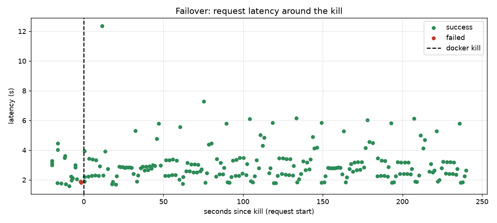

# AI tier test run - 20261128T175117Z

| Field | Value |
|---|---|
| Started (UTC) | 2026-11-28T17:51:17Z |
| Ended (UTC) | 2026-11-28T17:55:48Z |
| Tests run | preflight, failover |
| AI tool used to build the tests | Claude (Anthropic, claude.ai chat) (Claude Sonnet 5.5) |
| Who/what executed the tests | Human running tests/run_tests.sh |
| Prompt(s) | see `tests/PROMPTS.md` (copied below) |
| Git commit | fbf06fd |
| Endpoint | http://127.0.0.1:11434 |

## Summary

| Test | Result | PASS | FAIL | WARN | SKIP |
|---|---|---|---|---|---|
| preflight | PASS | 5 | 0 | 0 | 0 |
| failover | **FAIL** | 6 | 2 | 1 | 1 |

## preflight

Started 2026-11-28T17:51:17Z - ended 2026-11-28T17:51:19Z - result **PASS**

| ID | Check | Result | Detail |
|---|---|---|---|
| P1 | AI endpoint reachable through the load balancer | PASS | GET http://127.0.0.1:11434/ -> HTTP 200 |
| P2 | Model 'qwen2.5:1.5b' is staged | PASS | models listed: ['nomic-embed-text:latest', 'qwen2.5:1.5b'] |
| P3 | Two inference replicas are running | PASS | found 2: ['ai-tier-ollama-1', 'ai-tier-ollama-2'] |
| P4 | Load balancer container 'ai-lb' is running | PASS | state=running health=none |
| P5 | A real inference request succeeds end-to-end | PASS | HTTP 200 in 1.35s |

## failover

Started 2026-11-28T17:51:19Z - ended 2026-11-28T17:55:48Z - result **FAIL**

| ID | Check | Result | Detail |
|---|---|---|---|
| F1 | Two inference replicas running and target is one of them | PASS | replicas=['ai-tier-ollama-1', 'ai-tier-ollama-2']; will kill: ai-tier-ollama-1 |
| F2 | Baseline: requests succeed before the failure | PASS | 18/18 succeeded |
| F3 | Inference replica 'ai-tier-ollama-1' killed during active requests | PASS | ai-tier-ollama-1 (RestartCount before: 0) |
| F4 | Requests started after the kill keep succeeding via the remaining replica (>= 95.0%) | PASS | 204/204 = 100.0% ok; max latency 12.36s; failures: none |
| F5 | Requests that were mid-flight on the killed replica | WARN | 2 of 2 in-flight requests failed. nginx does not retry a POST that was already sent to an upstream unless 'non_idempotent' is added to proxy_next_upstream; this is the expected loss window. |
| F6 | Failure detected: replica left running/healthy (Docker state + healthcheck) | PASS | detected at t+0.2s; timeline: exited/unhealthy@0.2s |
| F7 | Load balancer stops routing to the failed replica (nginx passive health check) | PASS | 18 upstream error log lines since the kill; bound 28 (max_fails 2 + 1 probe per 10.0s fail_timeout over 240s + 2). Without removal, about half of all requests would log an error. Sample: 2026/11/28 17:51:44 [error] 30#30: *53 upstream prematurely closed connection while reading response header from upstream, client: 172.19.0.1, server: , request |
| F8 | Replica recovered automatically (Docker restart policy, no manual action) | **FAIL** | not healthy within 240.0s. Last state: ('exited', 'unhealthy'). Review, then restore manually with: docker start ai-tier-ollama-1 |
| F9 | Recovered replica serves client traffic again | SKIP | replica did not recover |
| F10 | End state: both replicas running and healthy, last requests succeed | **FAIL** | states={'ai-tier-ollama-1': ('exited', 'unhealthy'), 'ai-tier-ollama-2': ('running', 'healthy')}; last 3 requests ok=[True, True, True] |



## Commands run

```
17:51:17Z  $ uname -srm; python3 --version; docker --version; docker compose version; git rev-parse --short HEAD
17:51:17Z  $ docker ps --format 'table {{.Names}}\t{{.Image}}\t{{.Status}}'
17:51:17Z  $ python3 -u tests/ai_tests.py preflight --outdir tests/results/20261128T175117Z 
17:51:19Z  $ python3 -u tests/ai_tests.py failover --outdir tests/results/20261128T175117Z --confirm-disruptive
17:55:48Z  $ python3 tests/ai_tests.py report --outdir tests/results/20261128T175117Z
[preflight] 2026-11-28T17:51:17Z  $ docker ps --filter label=com.docker.compose.service=ollama --format '{{.Names}}'
[failover] 2026-11-28T17:51:19Z  $ docker ps --filter label=com.docker.compose.service=ollama --format '{{.Names}}'
[failover] 2026-11-28T17:51:44Z  $ docker kill ai-tier-ollama-1
[failover] 2026-11-28T17:55:48Z  $ docker logs --since 2026-11-28T17:51:44.864721Z ai-lb
```

## Environment

```
date_utc:  2026-11-28T17:51:17Z
host:      Linux 7.3.6-arch1-1 x86_64
python:    Python 3.14.10
docker:    Docker version 29.10.1, build c48360f51c
compose:   Docker Compose version 5.8.0
git:       fbf06fd
endpoint:  http://127.0.0.1:11434

NAMES              IMAGE                 STATUS
ai-lb              nginx:1.27.3-alpine   Up 33 seconds
ai-tier-ollama-2   ollama/ollama:0.5.7   Up 33 seconds (healthy)
ai-tier-ollama-1   ollama/ollama:0.5.7   Up 33 seconds (healthy)
```

## Prompt(s) used to generate these tests

<details><summary>Show prompts</summary>

# AI tool and prompts used

This file is copied into every `tests/results/<run>/run_record.md`.
Add a row to the table at the bottom whenever you (or an AI tool) change the tests or run them.

## Tool

| Item | Value |
|---|---|
| AI tool | Claude (Anthropic), claude.ai chat |
| Model | Claude Sonnet 5.5 |
| Date built | 2026-11-28 |
| Inputs given to the AI | `ai-tier/` source files only: `nginx-ai.conf`, `docker-compose.ai.yml`, `ai_client.py`, `.gitignore` |
| Secrets given to the AI | **None.** No passwords, keys, tokens or service-account files were shared. |

## Prompt 1 - building the tests (verbatim)

> AI load test: send concurrent requests to the AI endpoint at 1, 5, and 10 concurrent
> users (e.g., ab -p with a JSON body, hey, k6, or locust). Record latency (p50/p95),
> tokens per second, and error rate; chart the results and identify the bottleneck.
> AI failover: stop or kill one inference container (and/or VM) during active requests.
> Pass if requests keep succeeding through the remaining replica, the health check
> removes the failed replica, and it recovers automatically.
> Rate-limit test: send a burst of requests to the AI endpoint. Pass if HTTP 429
> responses are returned and the service remains healthy.
> Safety: disruptive tests (e.g., failover) run only when explicitly requested. Do not
> give the AI tool passwords, keys, tokens, or service account key files, and review
> each command before an AI tool runs it.
>
> can you make these tests follow this
>
> Use a generative AI tool (e.g., Claude, ChatGPT, or Gemini) to build the tests below.
> Tests are separate from the setup scripts and may be run either:
> o from a test script committed to GitHub (e.g., tests/run_tests.sh), or
> o by an AI tool that runs the tests for you (e.g., Claude Code, ChatGPT, or Gemini CLI executing commands).
> Document every test run (required for both options): the AI tool and prompt(s) used, the commands that
> were run, the date/time, the output, and a pass/fail result for each check. Commit the test logs to
> GitHub (e.g., tests/results/).

## Result of Prompt 1

`tests/run_tests.sh` (runner + safety gate), `tests/ai_tests.py` (preflight, load, ratelimit, failover, report),
`tests/README.md`, and this file. The AI tool read the nginx config and compose file so thresholds match the real
setup (5 r/s + burst 10 limiter, 2 replicas x `OLLAMA_NUM_PARALLEL=2` = 4 inference slots, 2-CPU replica limit,
`max_fails=2 fail_timeout=10s`).

## Human review log

Fill this in before committing results. Every command an AI tool runs must be reviewed by a human first.

| Date (UTC) | Who ran it | AI tool involved | Commands reviewed by | Notes |
|---|---|---|---|---|
| 11/28/26   | Evan T     | Claude           | Evan T|---|

</details>

## Raw output

<details><summary>preflight.log</summary>

```
[17:51:17] ======================================================================
[17:51:17] PREFLIGHT (read-only)
[17:51:17] ======================================================================
[17:51:17] [PASS] P1: AI endpoint reachable through the load balancer  -- GET http://127.0.0.1:11434/ -> HTTP 200
[17:51:17] [PASS] P2: Model 'qwen2.5:1.5b' is staged  -- models listed: ['nomic-embed-text:latest', 'qwen2.5:1.5b']
[17:51:17] $ docker ps --filter label=com.docker.compose.service=ollama --format '{{.Names}}'
[17:51:17] [PASS] P3: Two inference replicas are running  -- found 2: ['ai-tier-ollama-1', 'ai-tier-ollama-2']
[17:51:17] [PASS] P4: Load balancer container 'ai-lb' is running  -- state=running health=none
[17:51:17] Sending one small generation request ...
[17:51:19]   probe HTTP 200   1.35s tokens=8    tps= 16.3
[17:51:19] [PASS] P5: A real inference request succeeds end-to-end  -- HTTP 200 in 1.35s
[17:51:19] RESULT preflight: PASS
```

</details>

<details><summary>failover.log</summary>

```
[17:51:19] ======================================================================
[17:51:19] FAILOVER TEST (DISRUPTIVE: kills one inference container)
[17:51:19] ======================================================================
[17:51:19] $ docker ps --filter label=com.docker.compose.service=ollama --format '{{.Names}}'
[17:51:19] [PASS] F1: Two inference replicas running and target is one of them  -- replicas=['ai-tier-ollama-1', 'ai-tier-ollama-2']; will kill: ai-tier-ollama-1
[17:51:19] Warm-up: loading the model on both replicas
[17:51:23]   warmup c=4 #001 u01 HTTP 200   4.24s tokens=8    tps=  2.0
[17:51:23]   warmup c=4 #000 u03 HTTP 200   4.46s tokens=8    tps=  6.9
[17:51:24]   warmup c=4 #003 u02 HTTP 200   5.24s tokens=8    tps=  2.2
[17:51:24]   warmup c=4 #002 u00 HTTP 200   5.39s tokens=8    tps= 10.5
[17:51:24] Starting 3 steady users (paced, well below the nginx rate limit)
[17:51:24] Baseline traffic for 20.0s ...
[17:51:27]   t+   0.0s u0 HTTP 200   2.99s tokens=16   tps=  5.7
[17:51:27]   t+   0.0s u2 HTTP 200   3.12s tokens=16   tps=  5.4
[17:51:28]   t+   0.0s u1 HTTP 200   3.27s tokens=16   tps=  5.7
[17:51:30]   t+   3.5s u0 HTTP 200   1.79s tokens=16   tps=  9.8
[17:51:32]   t+   5.8s u0 HTTP 200   1.77s tokens=16   tps=  9.9
[17:51:32]   t+   3.6s u2 HTTP 200   4.01s tokens=16   tps=  4.5
[17:51:33]   t+   3.8s u1 HTTP 200   4.46s tokens=16   tps=  8.2
[17:51:35]   t+   8.7s u1 HTTP 200   1.71s tokens=16   tps= 10.3
[17:51:36]   t+   8.1s u0 HTTP 200   3.48s tokens=16   tps=  4.8
[17:51:36]   t+   8.1s u2 HTTP 200   3.61s tokens=16   tps=  6.6
[17:51:37]   t+  10.9s u1 HTTP 200   1.59s tokens=16   tps= 11.1
[17:51:39]   t+  12.2s u2 HTTP 200   1.96s tokens=16   tps= 10.1
[17:51:39]   t+  12.0s u0 HTTP 200   2.23s tokens=16   tps=  7.7
[17:51:39]   t+  13.0s u1 HTTP 200   2.13s tokens=16   tps=  9.7
[17:51:42]   t+  14.7s u2 HTTP 200   2.85s tokens=16   tps=  6.0
[17:51:42]   t+  15.7s u1 HTTP 200   2.04s tokens=16   tps=  8.5
[17:51:42]   t+  14.8s u0 HTTP 200   3.00s tokens=16   tps=  6.2
[17:51:44]   t+  18.1s u2 HTTP 200   1.87s tokens=16   tps=  9.0
[17:51:44] [PASS] F2: Baseline: requests succeed before the failure  -- 18/18 succeeded
[17:51:44] $ docker kill ai-tier-ollama-1
[17:51:44]   t+  18.3s u0 HTTP 502   1.80s tokens=0    tps=  0.0  ERR HTTP 502
[17:51:44]   t+  18.2s u1 HTTP 502   1.89s tokens=0    tps=  0.0  ERR HTTP 502
[17:51:45] [PASS] F3: Inference replica 'ai-tier-ollama-1' killed during active requests  -- ai-tier-ollama-1 (RestartCount before: 0)
[17:51:45] Watching the replica (docker inspect every 1.0s) while traffic continues ...
[17:51:45]   ai-tier-ollama-1: state=exited health=unhealthy  (t+0.2s after kill)
[17:51:47]   t+  20.4s u2 HTTP 200   1.90s tokens=16   tps=  8.9
[17:51:47]   t+  20.6s u1 HTTP 200   2.21s tokens=16   tps=  8.5
[17:51:49]   t+  20.6s u0 HTTP 200   3.94s tokens=16   tps=  8.6
[17:51:49]   t+  22.8s u2 HTTP 200   2.23s tokens=16   tps=  8.5
[17:51:51]   t+  23.3s u1 HTTP 200   3.44s tokens=16   tps=  8.3
[17:51:52]   t+  25.0s u0 HTTP 200   2.28s tokens=16   tps=  8.4
[17:51:53]   t+  25.6s u2 HTTP 200   3.37s tokens=16   tps=  8.3
[17:51:54]   t+  27.2s u1 HTTP 200   2.31s tokens=16   tps=  8.5
[17:51:55]   t+  27.8s u0 HTTP 200   3.34s tokens=16   tps=  8.4
[17:51:56]   t+  29.4s u2 HTTP 200   2.27s tokens=16   tps=  8.4
[17:51:57]   t+  30.0s u1 HTTP 200   2.91s tokens=16   tps= 10.6
[17:51:59]   t+  32.2s u2 HTTP 200   2.30s tokens=16   tps=  8.1
[17:52:02]   t+  33.4s u1 HTTP 200   3.93s tokens=16   tps=  6.2
[17:52:02]   t+  35.0s u2 HTTP 200   2.75s tokens=16   tps=  9.5
[17:52:04]   t+  37.9s u1 HTTP 200   1.71s tokens=16   tps=  9.9
[17:52:04]   t+  38.3s u2 HTTP 200   1.87s tokens=16   tps= 10.1
[17:52:06]   t+  40.1s u1 HTTP 200   1.69s tokens=16   tps= 10.3
[17:52:07]   t+  40.6s u2 HTTP 200   2.25s tokens=16   tps=  8.4
[17:52:08]   t+  31.6s u0 HTTP 200  12.36s tokens=16   tps=  8.4
[17:52:10]   t+  42.3s u1 HTTP 200   2.89s tokens=16   tps=  8.0
[17:52:11]   t+  43.4s u2 HTTP 200   2.87s tokens=16   tps=  8.0
[17:52:12]   t+  44.5s u0 HTTP 200   2.87s tokens=16   tps=  8.4
[17:52:13]   t+  45.7s u1 HTTP 200   2.82s tokens=16   tps=  8.2
[17:52:14]   t+  46.8s u2 HTTP 200   2.83s tokens=16   tps=  8.3
[17:52:15]   t+  47.9s u0 HTTP 200   2.84s tokens=16   tps=  8.4
[17:52:16]   t+  49.0s u1 HTTP 200   2.83s tokens=16   tps=  8.2
[17:52:17]   t+  50.1s u2 HTTP 200   2.81s tokens=16   tps=  8.4
[17:52:18]   t+  51.2s u0 HTTP 200   2.40s tokens=16   tps= 10.7
[17:52:20]   t+  53.4s u2 HTTP 200   1.90s tokens=16   tps=  9.9
[17:52:21]   t+  54.1s u0 HTTP 200   2.31s tokens=16   tps=  8.0
[17:52:22]   t+  52.3s u1 HTTP 200   5.30s tokens=16   tps=  8.3
[17:52:23]   t+  55.8s u2 HTTP 200   2.79s tokens=16   tps=  8.4
[17:52:24]   t+  56.9s u0 HTTP 200   2.89s tokens=16   tps=  8.4
[17:52:25]   t+  58.1s u1 HTTP 200   2.64s tokens=16   tps=  8.4
[17:52:26]   t+  59.1s u2 HTTP 200   2.90s tokens=16   tps=  8.4
[17:52:27]   t+  60.3s u0 HTTP 200   2.66s tokens=16   tps=  8.4
[17:52:29]   t+  61.3s u1 HTTP 200   2.92s tokens=16   tps=  8.4
[17:52:30]   t+  62.5s u2 HTTP 200   2.77s tokens=16   tps=  8.0
[17:52:31]   t+  63.5s u0 HTTP 200   3.01s tokens=16   tps=  8.0
[17:52:32]   t+  64.7s u1 HTTP 200   2.94s tokens=16   tps=  7.7
[17:52:35]   t+  65.8s u2 HTTP 200   4.77s tokens=16   tps=  6.2
[17:52:35]   t+  68.1s u1 HTTP 200   2.98s tokens=16   tps=  8.4
[17:52:37]   t+  67.0s u0 HTTP 200   5.79s tokens=16   tps=  8.3
[17:52:38]   t+  71.0s u2 HTTP 200   2.27s tokens=16   tps=  8.5
[17:52:39]   t+  71.6s u1 HTTP 200   3.33s tokens=16   tps=  8.4
[17:52:40]   t+  73.3s u0 HTTP 200   2.28s tokens=16   tps=  8.3
[17:52:41]   t+  73.8s u2 HTTP 200   3.34s tokens=16   tps=  8.4
[17:52:42]   t+  75.4s u1 HTTP 200   2.32s tokens=16   tps=  8.3
[17:52:44]   t+  76.0s u0 HTTP 200   3.37s tokens=16   tps=  8.1
[17:52:44]   t+  77.6s u2 HTTP 200   2.32s tokens=16   tps=  8.3
[17:52:46]   t+  78.3s u1 HTTP 200   3.31s tokens=16   tps=  8.5
[17:52:46]   t+  79.9s u0 HTTP 200   2.03s tokens=16   tps=  9.6
[17:52:48]   t+  82.1s u1 HTTP 200   1.74s tokens=16   tps=  9.8
[17:52:49]   t+  82.4s u0 HTTP 200   2.20s tokens=16   tps=  8.5
[17:52:50]   t+  80.5s u2 HTTP 200   5.55s tokens=16   tps=  8.3
[17:52:51]   t+  84.3s u1 HTTP 200   2.59s tokens=16   tps=  8.1
[17:52:53]   t+  85.1s u0 HTTP 200   3.14s tokens=16   tps=  8.3
[17:52:53]   t+  86.5s u2 HTTP 200   2.58s tokens=16   tps=  8.4
[17:52:55]   t+  87.4s u1 HTTP 200   3.06s tokens=16   tps=  8.4
[17:52:56]   t+  88.8s u0 HTTP 200   2.51s tokens=16   tps=  8.4
[17:52:57]   t+  89.6s u2 HTTP 200   3.04s tokens=16   tps=  8.4
[17:52:58]   t+  91.0s u1 HTTP 200   2.51s tokens=16   tps=  8.5
[17:52:59]   t+  91.8s u0 HTTP 200   3.03s tokens=16   tps=  8.4
[17:53:00]   t+  93.1s u2 HTTP 200   2.58s tokens=16   tps=  8.2
[17:53:01]   t+  94.0s u1 HTTP 200   2.72s tokens=16   tps= 10.0
[17:53:02]   t+  96.2s u2 HTTP 200   1.80s tokens=16   tps= 10.9
[17:53:04]   t+  97.2s u1 HTTP 200   2.46s tokens=16   tps=  7.5
[17:53:07]   t+  95.3s u0 HTTP 200   7.28s tokens=16   tps=  6.0
[17:53:07]   t+  98.5s u2 HTTP 200   4.37s tokens=16   tps=  8.6
[17:53:09]   t+ 100.2s u1 HTTP 200   4.46s tokens=16   tps=  9.3
[17:53:10]   t+ 103.1s u0 HTTP 200   2.23s tokens=16   tps=  8.3
[17:53:11]   t+ 103.4s u2 HTTP 200   3.41s tokens=16   tps=  8.4
[17:53:12]   t+ 105.1s u1 HTTP 200   2.39s tokens=16   tps=  8.5
[17:53:13]   t+ 105.8s u0 HTTP 200   3.15s tokens=16   tps=  8.4
[17:53:14]   t+ 107.3s u2 HTTP 200   2.38s tokens=16   tps=  8.5
[17:53:15]   t+ 108.0s u1 HTTP 200   2.82s tokens=16   tps= 10.5
[17:53:16]   t+ 110.2s u2 HTTP 200   1.84s tokens=16   tps= 10.7
[17:53:17]   t+ 111.3s u1 HTTP 200   1.82s tokens=16   tps= 10.7
[17:53:19]   t+ 112.5s u2 HTTP 200   2.20s tokens=16   tps=  8.6
[17:53:20]   t+ 109.5s u0 HTTP 200   5.80s tokens=16   tps=  8.5
[17:53:21]   t+ 113.6s u1 HTTP 200   3.31s tokens=16   tps=  8.3
[17:53:22]   t+ 115.2s u2 HTTP 200   2.27s tokens=16   tps=  8.4
[17:53:23]   t+ 115.8s u0 HTTP 200   3.35s tokens=16   tps=  8.4
[17:53:24]   t+ 117.5s u1 HTTP 200   2.29s tokens=16   tps=  8.3
[17:53:26]   t+ 118.0s u2 HTTP 200   3.48s tokens=16   tps=  7.8
[17:53:26]   t+ 119.6s u0 HTTP 200   2.43s tokens=16   tps=  7.9
[17:53:28]   t+ 120.2s u1 HTTP 200   3.47s tokens=16   tps=  8.2
[17:53:29]   t+ 122.0s u2 HTTP 200   2.33s tokens=16   tps=  8.2
[17:53:30]   t+ 122.6s u0 HTTP 200   3.07s tokens=16   tps=  9.9
[17:53:31]   t+ 124.8s u2 HTTP 200   1.91s tokens=16   tps= 10.3
[17:53:32]   t+ 126.1s u0 HTTP 200   1.83s tokens=16   tps= 10.6
[17:53:34]   t+ 127.2s u2 HTTP 200   2.25s tokens=16   tps=  8.5
[17:53:35]   t+ 124.2s u1 HTTP 200   6.09s tokens=16   tps=  7.9
[17:53:36]   t+ 128.5s u0 HTTP 200   3.34s tokens=16   tps=  7.8
[17:53:37]   t+ 130.0s u2 HTTP 200   2.80s tokens=16   tps=  7.4
[17:53:40]   t+ 130.8s u1 HTTP 200   5.03s tokens=16   tps=  5.8
[17:53:41]   t+ 132.3s u0 HTTP 200   4.29s tokens=16   tps=  7.9
[17:53:42]   t+ 133.3s u2 HTTP 200   4.83s tokens=16   tps=  8.2
[17:53:43]   t+ 136.3s u1 HTTP 200   2.47s tokens=16   tps=  8.3
[17:53:44]   t+ 137.1s u0 HTTP 200   2.79s tokens=16   tps= 10.8
[17:53:45]   t+ 139.3s u1 HTTP 200   1.78s tokens=16   tps= 11.0
[17:53:47]   t+ 140.4s u0 HTTP 200   1.79s tokens=16   tps= 10.8
[17:53:48]   t+ 141.6s u1 HTTP 200   2.28s tokens=16   tps=  8.3
[17:53:49]   t+ 138.6s u2 HTTP 200   5.85s tokens=16   tps=  8.1
[17:53:50]   t+ 142.7s u0 HTTP 200   3.45s tokens=16   tps=  8.1
[17:53:51]   t+ 144.4s u1 HTTP 200   2.41s tokens=16   tps=  7.9
[17:53:53]   t+ 145.0s u2 HTTP 200   3.47s tokens=16   tps=  8.1
[17:53:53]   t+ 146.6s u0 HTTP 200   2.37s tokens=16   tps=  8.3
[17:53:55]   t+ 147.3s u1 HTTP 200   3.42s tokens=16   tps=  8.1
[17:53:56]   t+ 148.9s u2 HTTP 200   2.34s tokens=16   tps=  8.3
[17:53:57]   t+ 149.5s u0 HTTP 200   3.42s tokens=16   tps=  8.3
[17:53:58]   t+ 151.2s u1 HTTP 200   2.29s tokens=16   tps=  8.3
[17:53:59]   t+ 151.8s u2 HTTP 200   2.94s tokens=16   tps= 10.6
[17:54:00]   t+ 154.0s u1 HTTP 200   1.83s tokens=16   tps= 10.6
[17:54:02]   t+ 155.2s u2 HTTP 200   2.06s tokens=16   tps=  9.3
[17:54:03]   t+ 156.3s u1 HTTP 200   2.40s tokens=16   tps=  7.9
[17:54:04]   t+ 153.4s u0 HTTP 200   6.16s tokens=16   tps=  7.9
[17:54:05]   t+ 157.8s u2 HTTP 200   3.24s tokens=16   tps=  8.0
[17:54:06]   t+ 159.2s u1 HTTP 200   2.67s tokens=16   tps=  8.0
[17:54:08]   t+ 160.1s u0 HTTP 200   3.18s tokens=16   tps=  8.2
[17:54:09]   t+ 161.5s u2 HTTP 200   2.71s tokens=16   tps=  7.9
[17:54:10]   t+ 162.4s u1 HTTP 200   3.38s tokens=16   tps=  7.3
[17:54:13]   t+ 163.8s u0 HTTP 200   4.89s tokens=16   tps=  5.9
[17:54:13]   t+ 164.7s u2 HTTP 200   4.11s tokens=16   tps=  8.4
[17:54:15]   t+ 166.3s u1 HTTP 200   4.17s tokens=16   tps= 10.5
[17:54:15]   t+ 169.3s u2 HTTP 200   1.82s tokens=16   tps= 10.8
[17:54:17]   t+ 171.0s u1 HTTP 200   1.84s tokens=16   tps= 10.3
[17:54:18]   t+ 171.7s u2 HTTP 200   2.24s tokens=16   tps=  8.4
[17:54:19]   t+ 169.2s u0 HTTP 200   5.84s tokens=16   tps=  8.4
[17:54:20]   t+ 173.3s u1 HTTP 200   2.81s tokens=16   tps=  8.4
[17:54:22]   t+ 174.4s u2 HTTP 200   2.80s tokens=16   tps=  8.4
[17:54:23]   t+ 175.5s u0 HTTP 200   2.80s tokens=16   tps=  8.4
[17:54:24]   t+ 176.6s u1 HTTP 200   2.79s tokens=16   tps=  8.4
[17:54:25]   t+ 177.7s u2 HTTP 200   2.80s tokens=16   tps=  8.4
[17:54:26]   t+ 178.8s u0 HTTP 200   2.82s tokens=16   tps=  8.3
[17:54:27]   t+ 179.9s u1 HTTP 200   2.85s tokens=16   tps=  8.4
[17:54:28]   t+ 181.0s u2 HTTP 200   2.83s tokens=16   tps=  8.4
[17:54:29]   t+ 182.1s u0 HTTP 200   2.39s tokens=16   tps= 10.7
[17:54:30]   t+ 184.3s u2 HTTP 200   1.83s tokens=16   tps= 10.2
[17:54:32]   t+ 185.0s u0 HTTP 200   2.17s tokens=16   tps=  8.8
[17:54:33]   t+ 183.2s u1 HTTP 200   5.29s tokens=16   tps=  8.3
[17:54:34]   t+ 186.7s u2 HTTP 200   2.73s tokens=16   tps=  8.4
[17:54:35]   t+ 187.7s u0 HTTP 200   3.07s tokens=16   tps=  8.3
[17:54:36]   t+ 189.0s u1 HTTP 200   2.56s tokens=16   tps=  8.4
[17:54:37]   t+ 189.9s u2 HTTP 200   3.17s tokens=16   tps=  7.9
[17:54:38]   t+ 191.2s u0 HTTP 200   2.65s tokens=16   tps=  8.4
[17:54:40]   t+ 192.1s u1 HTTP 200   3.20s tokens=16   tps=  8.3
[17:54:41]   t+ 193.6s u2 HTTP 200   2.68s tokens=16   tps=  7.8
[17:54:42]   t+ 194.4s u0 HTTP 200   3.20s tokens=16   tps=  7.9
[17:54:43]   t+ 195.8s u1 HTTP 200   2.84s tokens=16   tps=  7.6
[17:54:45]   t+ 196.7s u2 HTTP 200   4.16s tokens=16   tps=  8.1
[17:54:48]   t+ 199.1s u1 HTTP 200   4.56s tokens=16   tps=  6.2
[17:54:48]   t+ 198.1s u0 HTTP 200   6.03s tokens=16   tps=  8.5
[17:54:50]   t+ 201.4s u2 HTTP 200   4.47s tokens=16   tps=  8.5
[17:54:51]   t+ 204.2s u1 HTTP 200   2.26s tokens=16   tps=  8.3
[17:54:52]   t+ 204.6s u0 HTTP 200   3.45s tokens=16   tps=  8.4
[17:54:53]   t+ 206.4s u2 HTTP 200   2.28s tokens=16   tps=  8.4
[17:54:55]   t+ 207.0s u1 HTTP 200   3.31s tokens=16   tps=  8.4
[17:54:55]   t+ 208.6s u0 HTTP 200   2.27s tokens=16   tps=  8.4
[17:54:57]   t+ 209.2s u2 HTTP 200   3.29s tokens=16   tps=  8.5
[17:54:57]   t+ 210.8s u1 HTTP 200   2.23s tokens=16   tps=  8.6
[17:54:59]   t+ 211.3s u0 HTTP 200   2.87s tokens=16   tps= 10.8
[17:55:00]   t+ 213.5s u1 HTTP 200   1.81s tokens=16   tps= 10.8
[17:55:01]   t+ 214.7s u0 HTTP 200   1.84s tokens=16   tps= 10.6
[17:55:02]   t+ 215.8s u1 HTTP 200   2.25s tokens=16   tps=  8.4
[17:55:03]   t+ 213.0s u2 HTTP 200   5.82s tokens=16   tps=  8.4
[17:55:05]   t+ 217.1s u0 HTTP 200   3.19s tokens=16   tps=  8.4
[17:55:05]   t+ 218.5s u1 HTTP 200   2.42s tokens=16   tps=  8.3
[17:55:07]   t+ 219.3s u2 HTTP 200   3.17s tokens=16   tps=  8.5
[17:55:07]   t+ 220.8s u0 HTTP 200   2.40s tokens=16   tps=  8.4
[17:55:09]   t+ 221.5s u1 HTTP 200   3.16s tokens=16   tps=  8.4
[17:55:10]   t+ 222.9s u2 HTTP 200   2.40s tokens=16   tps=  8.4
[17:55:11]   t+ 223.7s u0 HTTP 200   3.17s tokens=16   tps=  8.5
[17:55:12]   t+ 225.1s u1 HTTP 200   2.37s tokens=16   tps=  8.5
[17:55:13]   t+ 225.8s u2 HTTP 200   2.74s tokens=16   tps= 10.9
[17:55:14]   t+ 228.0s u1 HTTP 200   1.88s tokens=16   tps= 10.2
[17:55:15]   t+ 229.1s u2 HTTP 200   1.87s tokens=16   tps= 10.2
[17:55:17]   t+ 230.4s u1 HTTP 200   2.30s tokens=16   tps=  8.0
[17:55:18]   t+ 227.3s u0 HTTP 200   6.14s tokens=16   tps=  7.6
[17:55:21]   t+ 231.4s u2 HTTP 200   5.01s tokens=16   tps=  5.9
[17:55:22]   t+ 233.2s u1 HTTP 200   4.12s tokens=16   tps=  8.3
[17:55:23]   t+ 234.0s u0 HTTP 200   4.70s tokens=16   tps=  8.4
[17:55:24]   t+ 237.0s u2 HTTP 200   2.55s tokens=16   tps=  8.4
[17:55:25]   t+ 237.8s u1 HTTP 200   3.07s tokens=16   tps=  8.4
[17:55:26]   t+ 239.2s u0 HTTP 200   2.52s tokens=16   tps=  8.4
[17:55:27]   t+ 240.0s u2 HTTP 200   2.64s tokens=16   tps= 10.7
[17:55:28]   t+ 242.2s u0 HTTP 200   1.89s tokens=16   tps= 10.2
[17:55:29]   t+ 243.2s u2 HTTP 200   2.00s tokens=16   tps=  9.7
[17:55:31]   t+ 241.4s u1 HTTP 200   5.27s tokens=16   tps=  8.5
[17:55:32]   t+ 244.6s u0 HTTP 200   2.78s tokens=16   tps=  8.4
[17:55:33]   t+ 245.7s u2 HTTP 200   3.22s tokens=16   tps=  8.3
[17:55:34]   t+ 247.1s u1 HTTP 200   2.44s tokens=16   tps=  8.4
[17:55:35]   t+ 247.9s u0 HTTP 200   3.19s tokens=16   tps=  8.4
[17:55:36]   t+ 249.4s u2 HTTP 200   2.40s tokens=16   tps=  8.3
[17:55:38]   t+ 250.1s u1 HTTP 200   3.19s tokens=16   tps=  8.3
[17:55:38]   t+ 251.6s u0 HTTP 200   2.41s tokens=16   tps=  8.5
[17:55:40]   t+ 252.3s u2 HTTP 200   3.17s tokens=16   tps=  8.4
[17:55:40]   t+ 253.8s u1 HTTP 200   2.36s tokens=16   tps=  8.5
[17:55:42]   t+ 254.5s u0 HTTP 200   2.75s tokens=16   tps= 10.8
[17:55:43]   t+ 256.6s u1 HTTP 200   1.82s tokens=16   tps= 10.7
[17:55:44]   t+ 257.7s u0 HTTP 200   1.83s tokens=16   tps= 10.6
[17:55:45] Replica did NOT become healthy within 240.0s.
[17:55:46]   t+ 258.9s u1 HTTP 200   2.25s tokens=16   tps=  8.4
[17:55:46]   t+ 255.9s u2 HTTP 200   5.80s tokens=16   tps=  8.5
[17:55:47]   t+ 260.0s u0 HTTP 200   2.64s tokens=16   tps= 13.2
[17:55:47] 
[17:55:47] Request classification relative to the kill:
[17:55:47]   before kill            n=18  ok=18  failed=0   p50=2.54s p95=4.08s max=4.46s
[17:55:47]   in flight at kill      n=2   ok=0   failed=2   p50=n/as p95=n/as max=n/as
[17:55:47]   started after kill     n=204 ok=204 failed=0   p50=2.79s p95=5.80s max=12.36s
[17:55:47] 
[17:55:48] [PASS] F4: Requests started after the kill keep succeeding via the remaining replica (>= 95.0%)  -- 204/204 = 100.0% ok; max latency 12.36s; failures: none
[17:55:48] [WARN] F5: Requests that were mid-flight on the killed replica  -- 2 of 2 in-flight requests failed. nginx does not retry a POST that was already sent to an upstream unless 'non_idempotent' is added to proxy_next_upstream; this is the expected loss window.
[17:55:48] [PASS] F6: Failure detected: replica left running/healthy (Docker state + healthcheck)  -- detected at t+0.2s; timeline: exited/unhealthy@0.2s
[17:55:48] $ docker logs --since 2026-11-28T17:51:44.864721Z ai-lb
[17:55:48] [PASS] F7: Load balancer stops routing to the failed replica (nginx passive health check)  -- 18 upstream error log lines since the kill; bound 28 (max_fails 2 + 1 probe per 10.0s fail_timeout over 240s + 2). Without removal, about half of all requests would log an error. Sample: 2026/11/28 17:51:44 [error] 30#30: *53 upstream prematurely closed connection while reading response header from upstream, client: 172.19.0.1, server: , request
[17:55:48] [FAIL] F8: Replica recovered automatically (Docker restart policy, no manual action)  -- not healthy within 240.0s. Last state: ('exited', 'unhealthy'). Review, then restore manually with: docker start ai-tier-ollama-1
[17:55:48] [SKIP] F9: Recovered replica serves client traffic again  -- replica did not recover
[17:55:48] [FAIL] F10: End state: both replicas running and healthy, last requests succeed  -- states={'ai-tier-ollama-1': ('exited', 'unhealthy'), 'ai-tier-ollama-2': ('running', 'healthy')}; last 3 requests ok=[True, True, True]
[17:55:48] RESULT failover: FAIL
```

</details>

