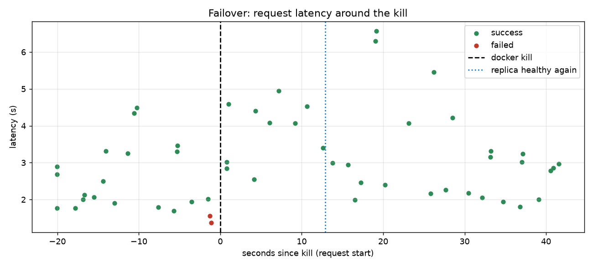

# AI tier test run - 20261128T181559Z

| Field | Value |
|---|---|
| Started (UTC) | 2026-11-28T18:15:59Z |
| Ended (UTC) | 2026-11-28T18:17:09Z |
| Tests run | preflight, failover |
| AI tool used to build the tests | Claude (Anthropic, claude.ai chat) (Claude Sonnet 5.5) |
| Who/what executed the tests | Human running tests/run_tests.sh |
| Prompt(s) | see `tests/PROMPTS.md` (copied below) |
| Git commit | f6c51fe |
| Endpoint | http://127.0.0.1:11434 |

## Summary

| Test | Result | PASS | FAIL | WARN | SKIP |
|---|---|---|---|---|---|
| preflight | PASS | 5 | 0 | 0 | 0 |
| failover | PASS | 9 | 0 | 1 | 0 |

## preflight

Started 2026-11-28T18:16:00Z - ended 2026-11-28T18:16:00Z - result **PASS**

| ID | Check | Result | Detail |
|---|---|---|---|
| P1 | AI endpoint reachable through the load balancer | PASS | GET http://127.0.0.1:11434/ -> HTTP 200 |
| P2 | Model 'qwen2.5:1.5b' is staged | PASS | models listed: ['nomic-embed-text:latest', 'qwen2.5:1.5b'] |
| P3 | Two inference replicas are running | PASS | found 2: ['ai-tier-ollama-1', 'ai-tier-ollama-2'] |
| P4 | Load balancer container 'ai-lb' is running | PASS | state=running health=none |
| P5 | A real inference request succeeds end-to-end | PASS | HTTP 200 in 0.59s |

## failover

Started 2026-11-28T18:16:00Z - ended 2026-11-28T18:17:09Z - result **PASS**

| ID | Check | Result | Detail |
|---|---|---|---|
| F1 | Two inference replicas running and target is one of them | PASS | replicas=['ai-tier-ollama-1', 'ai-tier-ollama-2']; will kill: ai-tier-ollama-1 |
| F2 | Baseline: requests succeed before the failure | PASS | 18/18 succeeded |
| F3 | Inference replica 'ai-tier-ollama-1' killed during active requests | PASS |  (RestartCount before: 0) |
| F4 | Requests started after the kill keep succeeding via the remaining replica (>= 95.0%) | PASS | 34/34 = 100.0% ok; max latency 6.57s; failures: none |
| F5 | Requests that were mid-flight on the killed replica | WARN | 2 of 3 in-flight requests failed. nginx does not retry a POST that was already sent to an upstream unless 'non_idempotent' is added to proxy_next_upstream; this is the expected loss window. |
| F6 | Failure detected: replica left running/healthy (Docker state + healthcheck) | PASS | detected at t+1.4s; timeline: running/healthy@0.3s -> running/starting@1.4s -> running/healthy@12.9s |
| F7 | Load balancer stops routing to the failed replica (nginx passive health check) | PASS | 2 upstream error log lines since the kill; bound 6 (max_fails 2 + 1 probe per 10.0s fail_timeout over 13s + 2). Without removal, about half of all requests would log an error. Sample: 2026/11/28 18:16:24 [error] 30#30: *71 upstream prematurely closed connection while reading response header from upstream, client: 172.19.0.1, server: , request |
| F8 | Replica recovered automatically (Docker restart policy, no manual action) | PASS | healthy again at t+12.9s; RestartCount 0 -> 1 |
| F9 | Recovered replica serves client traffic again through the load balancer | PASS | 16 /api/generate requests served by ai-tier-ollama-1 since the kill |
| F10 | End state: both replicas running and healthy, last requests succeed | PASS | states={'ai-tier-ollama-1': ('running', 'healthy'), 'ai-tier-ollama-2': ('running', 'healthy')}; last 3 requests ok=[True, True, True] |



## Commands run

```
18:16:00Z  $ uname -srm; python3 --version; docker --version; docker compose version; git rev-parse --short HEAD
18:16:00Z  $ docker ps --format 'table {{.Names}}\t{{.Image}}\t{{.Status}}'
18:16:00Z  $ python3 -u tests/ai_tests.py preflight --outdir tests/results/20261128T181559Z 
18:16:00Z  $ python3 -u tests/ai_tests.py failover --outdir tests/results/20261128T181559Z --confirm-disruptive
18:17:09Z  $ python3 tests/ai_tests.py report --outdir tests/results/20261128T181559Z
[preflight] 2026-11-28T18:16:00Z  $ docker ps --filter label=com.docker.compose.service=ollama --format '{{.Names}}'
[failover] 2026-11-28T18:16:00Z  $ docker ps --filter label=com.docker.compose.service=ollama --format '{{.Names}}'
[failover] 2026-11-28T18:16:23Z  $ docker exec ai-tier-ollama-1 kill -TERM 1
[failover] 2026-11-28T18:17:09Z  $ docker logs --since 2026-11-28T18:16:23.991908Z ai-lb
[failover] 2026-11-28T18:17:09Z  $ docker logs --since 2026-11-28T18:16:23.991908Z ai-tier-ollama-1
```

## Environment

```
date_utc:  2026-11-28T18:15:59Z
host:      Linux 7.3.6-arch1-1 x86_64
python:    Python 3.14.10
docker:    Docker version 29.10.1, build c48360f51c
compose:   Docker Compose version 5.8.0
git:       f6c51fe
endpoint:  http://127.0.0.1:11434

NAMES              IMAGE                 STATUS
ai-lb              nginx:1.27.3-alpine   Up 9 minutes
ai-tier-ollama-1   ollama/ollama:0.5.7   Up 9 minutes (healthy)
ai-tier-ollama-2   ollama/ollama:0.5.7   Up 9 minutes (healthy)
```

## Prompt(s) used to generate these tests

<details><summary>Show prompts</summary>

# AI tool and prompts used

This file is copied into every `tests/results/<run>/run_record.md`.
Add a row to the table at the bottom whenever you (or an AI tool) change the tests or run them.

## Tool

| Item | Value |
|---|---|
| AI tool | Claude (Anthropic), claude.ai chat |
| Model | Claude Sonnet 5.5 |
| Date built | 2026-11-28 |
| Inputs given to the AI | `ai-tier/` source files only: `nginx-ai.conf`, `docker-compose.ai.yml`, `ai_client.py`, `.gitignore` |
| Secrets given to the AI | **None.** No passwords, keys, tokens or service-account files were shared. |

## Prompt 1 - building the tests (verbatim)

> AI load test: send concurrent requests to the AI endpoint at 1, 5, and 10 concurrent
> users (e.g., ab -p with a JSON body, hey, k6, or locust). Record latency (p50/p95),
> tokens per second, and error rate; chart the results and identify the bottleneck.
> AI failover: stop or kill one inference container (and/or VM) during active requests.
> Pass if requests keep succeeding through the remaining replica, the health check
> removes the failed replica, and it recovers automatically.
> Rate-limit test: send a burst of requests to the AI endpoint. Pass if HTTP 429
> responses are returned and the service remains healthy.
> Safety: disruptive tests (e.g., failover) run only when explicitly requested. Do not
> give the AI tool passwords, keys, tokens, or service account key files, and review
> each command before an AI tool runs it.
>
> can you make these tests follow this
>
> Use a generative AI tool (e.g., Claude, ChatGPT, or Gemini) to build the tests below.
> Tests are separate from the setup scripts and may be run either:
> o from a test script committed to GitHub (e.g., tests/run_tests.sh), or
> o by an AI tool that runs the tests for you (e.g., Claude Code, ChatGPT, or Gemini CLI executing commands).
> Document every test run (required for both options): the AI tool and prompt(s) used, the commands that
> were run, the date/time, the output, and a pass/fail result for each check. Commit the test logs to
> GitHub (e.g., tests/results/).

## Result of Prompt 1

`tests/run_tests.sh` (runner + safety gate), `tests/ai_tests.py` (preflight, load, ratelimit, failover, report),
`tests/README.md`, and this file. The AI tool read the nginx config and compose file so thresholds match the real
setup (5 r/s + burst 10 limiter, 2 replicas x `OLLAMA_NUM_PARALLEL=2` = 4 inference slots, 2-CPU replica limit,
`max_fails=2 fail_timeout=10s`).

## Human review log

Fill this in before committing results. Every command an AI tool runs must be reviewed by a human first.

| Date (UTC) | Who ran it | AI tool involved | Commands reviewed by | Notes |
|---|---|---|---|---|
| 11/28/26   | Evan T     | Claude           | Evan T|---|

</details>

## Raw output

<details><summary>preflight.log</summary>

```
[18:16:00] ======================================================================
[18:16:00] PREFLIGHT (read-only)
[18:16:00] ======================================================================
[18:16:00] [PASS] P1: AI endpoint reachable through the load balancer  -- GET http://127.0.0.1:11434/ -> HTTP 200
[18:16:00] [PASS] P2: Model 'qwen2.5:1.5b' is staged  -- models listed: ['nomic-embed-text:latest', 'qwen2.5:1.5b']
[18:16:00] $ docker ps --filter label=com.docker.compose.service=ollama --format '{{.Names}}'
[18:16:00] [PASS] P3: Two inference replicas are running  -- found 2: ['ai-tier-ollama-1', 'ai-tier-ollama-2']
[18:16:00] [PASS] P4: Load balancer container 'ai-lb' is running  -- state=running health=none
[18:16:00] Sending one small generation request ...
[18:16:00]   probe HTTP 200   0.59s tokens=8    tps= 16.5
[18:16:00] [PASS] P5: A real inference request succeeds end-to-end  -- HTTP 200 in 0.59s
[18:16:00] RESULT preflight: PASS
```

</details>

<details><summary>failover.log</summary>

```
[18:16:00] ======================================================================
[18:16:00] FAILOVER TEST (DISRUPTIVE: kills one inference container)
[18:16:00] ======================================================================
[18:16:00] $ docker ps --filter label=com.docker.compose.service=ollama --format '{{.Names}}'
[18:16:00] [PASS] F1: Two inference replicas running and target is one of them  -- replicas=['ai-tier-ollama-1', 'ai-tier-ollama-2']; will kill: ai-tier-ollama-1
[18:16:00] Warm-up: loading the model on both replicas
[18:16:03]   warmup c=4 #003 u02 HTTP 200   2.71s tokens=8    tps=  3.2
[18:16:03]   warmup c=4 #000 u03 HTTP 200   2.79s tokens=8    tps=  3.1
[18:16:03]   warmup c=4 #002 u01 HTTP 200   2.94s tokens=8    tps=  6.6
[18:16:03]   warmup c=4 #001 u00 HTTP 200   2.99s tokens=8    tps=  6.9
[18:16:03] Starting 3 steady users (paced, well below the nginx rate limit)
[18:16:03] Baseline traffic for 20.0s ...
[18:16:05]   t+   0.0s u0 HTTP 200   1.77s tokens=16   tps= 10.0
[18:16:06]   t+   0.0s u1 HTTP 200   2.68s tokens=16   tps=  6.4
[18:16:06]   t+   0.0s u2 HTTP 200   2.89s tokens=16   tps=  6.6
[18:16:07]   t+   2.3s u0 HTTP 200   1.76s tokens=16   tps= 10.0
[18:16:09]   t+   3.2s u1 HTTP 200   2.00s tokens=16   tps=  8.7
[18:16:09]   t+   3.4s u2 HTTP 200   2.13s tokens=16   tps=  9.5
[18:16:10]   t+   4.5s u0 HTTP 200   2.06s tokens=16   tps=  9.8
[18:16:12]   t+   5.7s u1 HTTP 200   2.50s tokens=16   tps=  6.8
[18:16:12]   t+   7.1s u0 HTTP 200   1.90s tokens=16   tps=  9.1
[18:16:13]   t+   6.0s u2 HTTP 200   3.31s tokens=16   tps=  5.6
[18:16:15]   t+   8.7s u1 HTTP 200   3.26s tokens=16   tps=  5.7
[18:16:17]   t+   9.5s u0 HTTP 200   4.34s tokens=16   tps=  4.3
[18:16:18]   t+  12.4s u1 HTTP 200   1.79s tokens=16   tps=  9.8
[18:16:18]   t+   9.8s u2 HTTP 200   4.49s tokens=16   tps=  7.1
[18:16:19]   t+  14.3s u0 HTTP 200   1.69s tokens=16   tps= 10.1
[18:16:21]   t+  14.7s u1 HTTP 200   3.30s tokens=16   tps=  5.2
[18:16:22]   t+  14.8s u2 HTTP 200   3.46s tokens=16   tps=  5.3
[18:16:22]   t+  16.5s u0 HTTP 200   1.94s tokens=16   tps=  9.2
[18:16:23] [PASS] F2: Baseline: requests succeed before the failure  -- 18/18 succeeded
[18:16:23] $ docker exec ai-tier-ollama-1 kill -TERM 1
[18:16:24]   t+  19.0s u0 HTTP 502   1.37s tokens=0    tps=  0.0  ERR HTTP 502
[18:16:24]   t+  18.8s u2 HTTP 502   1.55s tokens=0    tps=  0.0  ERR HTTP 502
[18:16:24] [PASS] F3: Inference replica 'ai-tier-ollama-1' killed during active requests  --  (RestartCount before: 0)
[18:16:24] Watching the replica (docker inspect every 1.0s) while traffic continues ...
[18:16:24]   ai-tier-ollama-1: state=running health=healthy  (t+0.3s after kill)
[18:16:24]   t+  18.5s u1 HTTP 200   2.02s tokens=16   tps=  8.4
[18:16:25]   ai-tier-ollama-1: state=running health=starting  (t+1.4s after kill)
[18:16:27]   t+  20.8s u2 HTTP 200   2.84s tokens=16   tps=  5.9
[18:16:27]   t+  20.8s u0 HTTP 200   3.01s tokens=16   tps=  8.5
[18:16:29]   t+  21.0s u1 HTTP 200   4.59s tokens=16   tps=  9.3
[18:16:30]   t+  24.2s u2 HTTP 200   2.55s tokens=16   tps=  7.3
[18:16:32]   t+  24.4s u0 HTTP 200   4.41s tokens=16   tps=  5.7
[18:16:34]   t+  26.1s u1 HTTP 200   4.08s tokens=16   tps=  5.1
[18:16:36]   t+  27.2s u2 HTTP 200   4.95s tokens=16   tps=  5.4
[18:16:36]   ai-tier-ollama-1: state=running health=healthy  (t+12.9s after kill)
[18:16:36] Replica healthy again after 12.9s. Keeping traffic on for 30.0s more ...
[18:16:37]   t+  29.3s u0 HTTP 200   4.06s tokens=16   tps=  6.1
[18:16:39]   t+  30.7s u1 HTTP 200   4.52s tokens=16   tps=  5.9
[18:16:40]   t+  32.7s u2 HTTP 200   3.40s tokens=16   tps=  8.8
[18:16:40]   t+  33.8s u0 HTTP 200   3.00s tokens=16   tps=  6.5
[18:16:42]   t+  36.6s u2 HTTP 200   2.00s tokens=16   tps=  8.8
[18:16:42]   t+  35.7s u1 HTTP 200   2.95s tokens=16   tps=  6.4
[18:16:43]   t+  37.3s u0 HTTP 200   2.46s tokens=16   tps=  8.2
[18:16:46]   t+  40.3s u0 HTTP 200   2.40s tokens=16   tps=  7.2
[18:16:49]   t+  39.1s u2 HTTP 200   6.29s tokens=16   tps=  2.6
[18:16:49]   t+  39.2s u1 HTTP 200   6.57s tokens=16   tps=  5.1
[18:16:51]   t+  43.2s u0 HTTP 200   4.07s tokens=16   tps=  4.5
[18:16:51]   t+  45.9s u2 HTTP 200   2.17s tokens=16   tps=  8.1
[18:16:53]   t+  47.8s u0 HTTP 200   2.26s tokens=16   tps=  8.7
[18:16:55]   t+  46.3s u1 HTTP 200   5.45s tokens=16   tps=  4.0
[18:16:56]   t+  50.5s u0 HTTP 200   2.18s tokens=16   tps=  8.0
[18:16:56]   t+  48.6s u2 HTTP 200   4.21s tokens=16   tps=  6.5
[18:16:58]   t+  52.2s u1 HTTP 200   2.06s tokens=16   tps= 10.1
[18:17:00]   t+  53.2s u0 HTTP 200   3.15s tokens=16   tps=  5.4
[18:17:00]   t+  53.3s u2 HTTP 200   3.32s tokens=16   tps=  5.6
[18:17:00]   t+  54.8s u1 HTTP 200   1.94s tokens=16   tps=  9.0
[18:17:02]   t+  56.8s u0 HTTP 200   1.80s tokens=16   tps=  9.4
[18:17:04]   t+  57.1s u2 HTTP 200   3.02s tokens=16   tps=  5.7
[18:17:04]   t+  57.2s u1 HTTP 200   3.24s tokens=16   tps=  5.9
[18:17:05]   t+  59.2s u0 HTTP 200   2.00s tokens=16   tps=  8.9
[18:17:07]   t+  60.6s u2 HTTP 200   2.79s tokens=16   tps=  6.1
[18:17:07]   t+  61.0s u1 HTTP 200   2.85s tokens=16   tps=  6.3
[18:17:08]   t+  61.6s u0 HTTP 200   2.97s tokens=16   tps=  6.6
[18:17:08] 
[18:17:08] Request classification relative to the kill:
[18:17:08]   before kill            n=18  ok=18  failed=0   p50=2.31s p95=4.36s max=4.49s
[18:17:08]   in flight at kill      n=3   ok=1   failed=2   p50=2.02s p95=2.02s max=2.02s
[18:17:08]   started after kill     n=34  ok=34  failed=0   p50=3.00s p95=5.75s max=6.57s
[18:17:08] 
[18:17:09] [PASS] F4: Requests started after the kill keep succeeding via the remaining replica (>= 95.0%)  -- 34/34 = 100.0% ok; max latency 6.57s; failures: none
[18:17:09] [WARN] F5: Requests that were mid-flight on the killed replica  -- 2 of 3 in-flight requests failed. nginx does not retry a POST that was already sent to an upstream unless 'non_idempotent' is added to proxy_next_upstream; this is the expected loss window.
[18:17:09] [PASS] F6: Failure detected: replica left running/healthy (Docker state + healthcheck)  -- detected at t+1.4s; timeline: running/healthy@0.3s -> running/starting@1.4s -> running/healthy@12.9s
[18:17:09] $ docker logs --since 2026-11-28T18:16:23.991908Z ai-lb
[18:17:09] [PASS] F7: Load balancer stops routing to the failed replica (nginx passive health check)  -- 2 upstream error log lines since the kill; bound 6 (max_fails 2 + 1 probe per 10.0s fail_timeout over 13s + 2). Without removal, about half of all requests would log an error. Sample: 2026/11/28 18:16:24 [error] 30#30: *71 upstream prematurely closed connection while reading response header from upstream, client: 172.19.0.1, server: , request
[18:17:09] [PASS] F8: Replica recovered automatically (Docker restart policy, no manual action)  -- healthy again at t+12.9s; RestartCount 0 -> 1
[18:17:09] $ docker logs --since 2026-11-28T18:16:23.991908Z ai-tier-ollama-1
[18:17:09] [PASS] F9: Recovered replica serves client traffic again through the load balancer  -- 16 /api/generate requests served by ai-tier-ollama-1 since the kill
[18:17:09] [PASS] F10: End state: both replicas running and healthy, last requests succeed  -- states={'ai-tier-ollama-1': ('running', 'healthy'), 'ai-tier-ollama-2': ('running', 'healthy')}; last 3 requests ok=[True, True, True]
[18:17:09] RESULT failover: PASS
```

</details>

